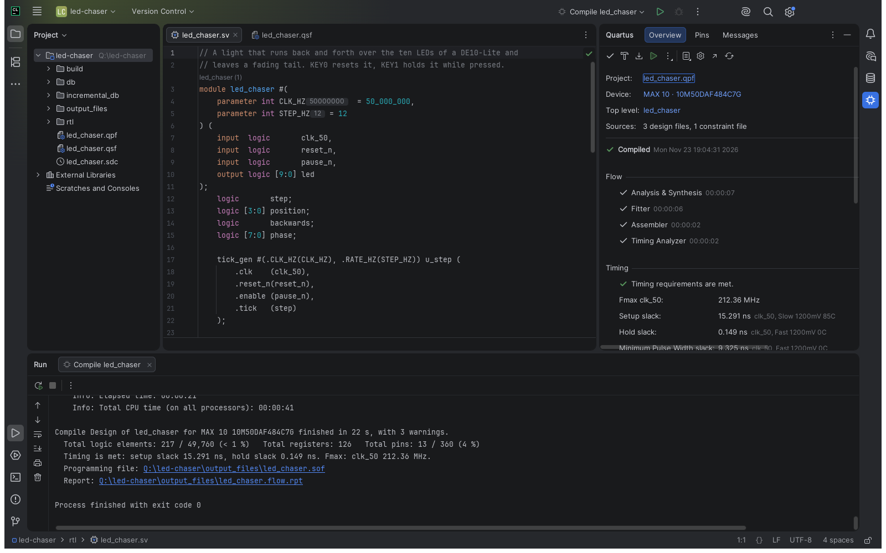
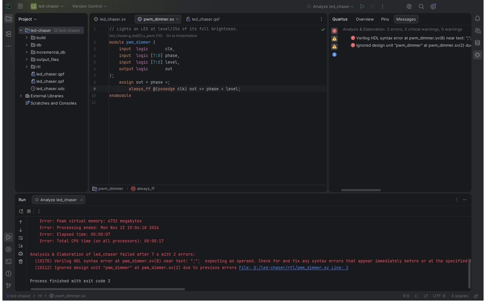
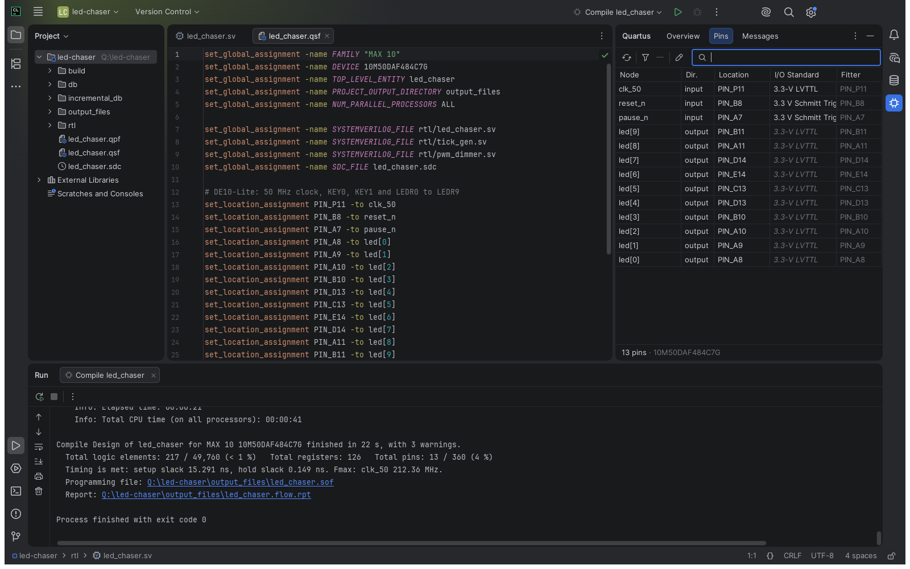

# Verilog Toolbox

Verilog and SystemVerilog support for CLion.

## Features

- Syntax highlighting, commenting, brace and quote matching for `.v`, `.vh`, `.sv`, `.svh`
- Code folding, live templates (`always_ff`, `always_comb`, `case`, `module`, …) and
  **New | Verilog/SystemVerilog File**
- Diagnostics, navigation, hover, completion, rename, inlay hints, structure view and breadcrumbs via the
  [slang-server](https://github.com/hudson-trading/slang-server) language server, downloaded automatically
- [Verilator](https://verilator.org) lint as a second source of diagnostics: width mismatches, incomplete cases,
  inferred latches, multiple drivers and the like, as you type
- Optional [Verible](https://github.com/chipsalliance/verible) language server for formatting and style lint
- Run testbenches with [Icarus Verilog](https://github.com/steveicarus/iverilog) from the gutter, or all
  testbenches of a folder at once, with a pass/fail tree
- Simulate with [Verilator](https://verilator.org) instead: Verilog testbenches with `--timing`, or C++
  testbenches that drive the Verilated model, built with CMake into a project CLion loads to debug them
- **Generate Testbench** for a module: instance, clock, reset and waveform dump already written
- **Check Synthesis** of a module with [Yosys](https://yosyshq.net/yosys/): what does not synthesize, multiple
  drivers, logic loops and latches, and the resources it takes, as generic gates or for an FPGA family
- [Quartus Prime](https://www.altera.com/products/development-tools/quartus) without its window: compile,
  program the device, assign pins and read timing and resource reports from the IDE, with the design of the
  `.qsf` shared with every other tool
- [GOWIN EDA](https://www.gowinsemi.com/en/support/download_eda/) without its window: build and program a
  `.gprj` project, assign pins, I/O types, pull modes and drive in a table, and read the timing, resources and
  messages of the last build, with the design shared with every other tool
- Program the FPGA with [openFPGALoader](https://github.com/trabucayre/openFPGALoader): build the bitstream,
  load it into SRAM or write it to flash, with the board and bitstream read from the project's Makefile
- One click from Verilog to a Gowin board without a Makefile: the plugin builds the bitstream with Yosys,
  nextpnr-himbaechel and gowin_pack, with presets for the Sipeed Tang boards, and programs it
- Highlighting and checks for Gowin physical constraint files (`.cst`): names that are no port of the top
  module and ports without a pin are pointed out
- Open waveforms in [GTKWave](https://gtkwave.sourceforge.net) or [Surfer](https://surfer-project.org);
  the viewer reloads after every re-run, and **Add to Waveform** in the editor shows the signal at the caret
  in it

Tool paths live in **Settings → Tools → Verilog Toolbox**. Verible and the OSS CAD Suite can be downloaded
from there if they're not installed. Verible has no prebuilt binary for Intel Macs; install it with
`brew tap chipsalliance/verible && brew install verible` and it is found without setting a path.

### OSS CAD Suite

Icarus Verilog, Verilator, Yosys, GTKWave and openFPGALoader come together in the nightly
[OSS CAD Suite](https://github.com/YosysHQ/oss-cad-suite-build), which the settings, the run configuration and
the notification about a missing tool offer to download (500–750 MB, 2–2.5 GB unpacked). The whole suite is
kept, the FPGA tools included, and an update removes the build it replaces. A tool whose path is left empty is
taken from the suite, or else from your `PATH`; GTKWave is the exception and comes from the suite only when
no GTKWave of your own is installed.

### Verilator lint

When Verilator is found, each open `.v` and `.sv` file is linted with `verilator --lint-only` as you edit it,
unsaved changes included, and its warnings and errors show up next to slang-server's. Files are linted in the
design file list when one is selected, and otherwise with the project's directories searched for the modules
they use. Extra options, such as `-Wall` for the style warnings, and a switch to turn the lint off are in the
settings. Syntax errors are left to slang-server, which reports them more precisely.

### Verilator simulation

Verilator simulates much faster than Icarus Verilog and knows far more SystemVerilog. Choose it under
**Settings → Tools → Verilog Toolbox → Simulation**, and the run icon of a testbench and **Run 'Testbenches in …'**
of a directory use it; run configurations of the type *Verilator* can be made by hand either way. Results show
in the same test tree: a testbench fails when Verilator or the C++ build fails, when the simulation exits
non-zero, or when it reports `$error`, `$fatal` or a failing assertion.

**Verilog testbenches** are verilated with `--main --timing`, so the delays, clocks and `initial` blocks of an
ordinary testbench, such as one of **Generate Testbench**, run as they do in Icarus Verilog. The design comes from
the file list as for Icarus runs. Warnings are shown but do not stop the build (`-Wno-fatal` in the run
configuration's Verilator options). A `$dumpfile` makes Verilator trace the waveform, as FST when the file is
called `.fst` and otherwise as VCD, and **Open Waveform** and the reload after a re-run work as with Icarus.

**C++ testbenches.** A C++ file that includes a Verilated model, `#include "Vcounter.h"` for the module
`counter`, has **Run 'counter_tb'** in its context menu. **Generate Verilator C++ Testbench** on a module writes
one: the model, a VCD trace, the clock and reset driven as the Verilog testbench does it, and a `CHECK` macro
whose failures show in the test tree with their place. Other C++ files of the testbench go in the run
configuration.

**CMake and CLion.** The simulation is built with CMake, not with Verilator's Makefiles or its CMake package,
which need `make`, Python or Perl. Each run verilates the design, writes `build/verilator/<testbench>/CMakeLists.txt`
from Verilator's list of the files it generated, and builds it in `build/verilator/cmake-build-run` with the
CMake and Ninja on your `PATH`, or else CLion's own, and on Windows CLion's MinGW. **Load CMake Project in
CLion** in the toolbar of the run loads `build/verilator/CMakeLists.txt`, which takes in every simulation of the
project, into CLion: its CMake application and CTest configurations then build, run and debug the simulations,
C++ testbench and Verilated model included, with CLion's toolchain, debugger and test runner. Changing a Verilog
source verilates it again when CLion builds; when the design gains modules or files, run the configuration once
from the IDE so that the list of generated files is written again.

### Check Synthesis

**Check Synthesis** (editor, project view or **Tools**) runs the module at the caret, or the file's module, and
everything below it through Yosys in the Run tool window. The console shows Yosys's warnings and errors with
links to the source, then the cell statistics and a summary such as
`counter synthesizes for Lattice iCE40 to 11 cells: 5 LUTs, 4 flip-flops, 2 other.` Inferred latches are
pointed out. The cells counted are generic gates, or those of iCE40, ECP5, Gowin or Xilinx 7-series, as chosen
in the settings.

The design is read from the design file list when one is selected. SystemVerilog is read with the
[yosys-slang](https://github.com/povik/yosys-slang) front end when Yosys has it, as the OSS CAD Suite's does,
so that Yosys sees the design as slang-server does. Runs happen in `build/synth/<module>/` of the project,
which keeps the script, the full `yosys.log` and the statistics.

### Quartus Prime

A project with a Quartus Prime project in it (`.qpf`, or a `.qsf` alone) gets a **Quartus** tool window, and
its Quartus project needs no setting up: it is found when the IDE project opens, and Quartus is found where
`QUARTUS_ROOTDIR` points, on your `PATH` or where it installs by default (`C:\altera_lite`, `C:\intelFPGA_lite`,
`~/altera_pro` and the like, the newest version). Lite, Standard and Pro editions work.



**Compiling.** The toolbar of the tool window and **Tools | Quartus Prime** run *Analysis & Elaboration* for a
quick check, *Compile Design*, and the single steps (synthesis, Fitter, Assembler, timing analysis) for running
one again. Each is an ordinary run configuration, so it can be run again with the run widget. The console shows
Quartus's messages coloured by severity, links every `File: … Line: …` to the source, leaves out the legal
notice every tool prints, and ends with a summary: resources, whether timing is met with the worst slacks and
Fmax, the programming file, and after a failure the errors once more. Right-clicking a `.qpf` or `.qsf` offers
**Run 'Compile …'** too.



**Programming.** *Program Device* and *Compile Design and Program Device* run `quartus_pgm`. The cable that is
connected is used, and the project's device is found in a JTAG chain of several, such as behind the processor
of an SoC board. The `.sof` configures the FPGA until it loses power; the run configuration can write the `.pof`
to flash instead, or any other file, and has the cable, the mode, the operation letters, the device index and
extra options for when the defaults do not fit.

**Overview.** The tool window shows the device, the top-level entity, the steps of the last compilation with
their times, timing (Fmax and the worst slack of each check, failing ones in red), the resources used and
links to the reports, which open in the editor. It says when sources changed since the last compilation and
when a project has no timing constraints.

**Pins.** The *Pins* tab lists the ports of the top-level entity, one row per bit, with their location and I/O
standard. Both are edited in place and written to the `.qsf` as you would write them yourself, one undoable
step each. After a Fitter run the free pins of the device are offered and the pins the Fitter chose are
shown. Two ports on one pin are marked.



**Messages.** The *Messages* tab has the messages of the last run by severity, with their details below them;
double-click goes to the source. Before a run in the IDE it shows those of the reports, whoever compiled.

**Reports.** The reports (`.rpt`) and the pin-out file (`.pin`) open in a viewer of their sections instead of
as walls of text. The sections are listed on the left, the operating corners of timing, state machines and
the parameters of each instance grouped, and a search there finds what you type in titles and contents
alike. Tables sort by any column, numbers as numbers, and filter as you type; the hierarchy of an entity is
set in, resources used get a gauge, failures and negative slack are red. The messages are filtered by
severity, and a double-click goes to the source. The title says whether the step succeeded or timing is met.
*Show in text*, or the buttons at the top right of the editor, show the report's text next to it or alone.

**The project.** **New Quartus Project…** writes a `.qpf` and `.qsf` for a device chosen from the ones your
Quartus has installed, with the project's Verilog sources and, if you like, an `.sdc` with a clock constraint.
**Add to / Remove from Quartus Project** and **Set as Quartus Top-Level Entity** are in the context menu of
files, **Device…** changes the device. `.qsf`, `.qpf`, `.qip` and `.sdc` files are highlighted and complete
commands, assignment names (all of those your Quartus knows) and common values. **Open in Quartus Prime** is
there for what remains.

**The design.** The `.qsf` describes the design to the other tools as well: slang-server, Verilator lint,
Check Synthesis and Icarus Verilog runs read its sources, search paths, macros and top-level entity, also
those of the `.qip` files it lists. A file list is written from it to `build/quartus/<revision>.f` and kept
up to date. Megafunctions and primitives such as `altpll` are taken from Quartus's simulation libraries, which
can be switched off in the settings. **Stop Using Quartus Project as Design** goes back to how it was; a `.f`
file or a top level selected by hand is never replaced.

### GOWIN EDA

A project with a GOWIN EDA project in it (`.gprj`) gets a **GOWIN EDA** tool window, and the project needs no
setting up: it is found when the IDE project opens, and GOWIN EDA is found on your `PATH` or where it installs
by default (`C:\Gowin\Gowin_V…`, `~/gowin`, `/opt/gowin`, the newest version), or where Settings | Tools |
Verilog Toolbox says. The Standard and the Education edition work.

**Building.** The toolbar of the tool window and **Tools | GOWIN EDA** run *Synthesize*, *Place & Route* and
*Run All*, through `gw_sh` as GOWIN EDA's own IDE does. Each is an ordinary run configuration, so it can be run
again with the run widget. The console colours the messages by severity, links every file they name to the
line, and ends with a summary: the resources, whether timing is met with the worst slacks and Fmax, the
bitstream, and after a failure the errors once more. Left to itself, GOWIN EDA takes the first module nothing
instantiates for the top, which may be a leftover; when the project names none, the plugin takes the module
whose ports the `.cst` places, and says so. Right-clicking a `.gprj` offers **Run 'Build …'** too.

**Programming.** *Program Device* and *Run All and Program Device* run GOWIN's `programmer_cli` with the
project's device and bitstream. The bitstream goes to SRAM by default; the run configuration writes it to
flash instead, choosing the embedded flash of the LittleBee devices or the external SPI flash of the Arora
ones, or runs any other operation of the programmer, with the cable, the JTAG frequency and extra options for
when the defaults do not fit. The Sipeed Tang boards work with the default cable.

**Overview.** The tool window shows the device with its LUTs, registers and I/Os, the top module, the steps of
the last build with their times, timing (Fmax against what the `.sdc` asks, and the worst slack of each check,
failing ones in red), the resources used and links to the reports. It says when sources changed since the last
build and when a project has no pin or no timing constraints.

**Pins.** The *Pins* tab lists the ports of the top module, one row per bit, with their pin, I/O type, pull
mode and drive, all edited in place and written to the `.cst` as `IO_LOC` and `IO_PORT` statements, one
undoable step each; a project without a `.cst` gets one. The pins of the device's package are offered with
their bank and what else they do (`GCLKT_3`, `TMS`, …), and the I/O types the device supports for the port's
direction, both from GOWIN EDA's own tables. After a build the pins and settings place and route used are
shown, those the `.cst` leaves open greyed. Two ports on one pin, and pins the package does not have, are marked.

**Messages.** The *Messages* tab has the errors and warnings of the last run, notes on request; double-click
goes to the source or the line of the `.cst`. Before a run in the IDE it shows those of the logs in `impl`.

**Reports.** The reports in `impl` open in the same viewer as Quartus's: the place and route report
(`.rpt.txt`), the timing report (`.tr`), the logs of synthesis and of place and route, and the HTML reports of
synthesis, power and pins. The sections are listed on the left under their headings (the summaries of timing,
the tables of paths, each path of the detailed analysis with its slack and end points) and searched by title and
contents. Tables sort and filter, parts of a resource are set in and get a gauge, negative slack is red; the
messages of a log are filtered by severity and lead to the source. The title says whether timing is met, whether
a step succeeded, or the total power. The text, or the HTML, is one click away.

**The project.** **New GOWIN EDA Project…** writes a `.gprj` for a part from GOWIN EDA's catalog, or for a
Sipeed Tang board, with the project's Verilog sources, a `.cst` and an `.sdc` with the board's clock.
**Add to / Remove from GOWIN EDA Project** and **Set as GOWIN EDA Top Module** are in the context menu of files,
**Device…** changes the part. The `.gprj` and the options in `impl/project_process_config.json` are changed
as GOWIN EDA writes them, so that its IDE opens the same project: **Open in GOWIN EDA** is there for what
remains, such as the FloorPlanner and the IP Core Generator.

**The design.** The `.gprj` describes the design to the other tools as well: slang-server, Verilator lint,
Check Synthesis and Icarus Verilog runs read its sources, include paths and top module. A file list is written
from it to `build/gowin-eda/<project>.f` and kept up to date. **Stop Using GOWIN EDA Project as Design** goes
back to how it was.

### openFPGALoader

[openFPGALoader](https://github.com/trabucayre/openFPGALoader) programs the FPGAs of most vendors over the
cables of most boards: Gowin, Lattice, AMD Xilinx, Altera, Efinix, Anlogic and more. It comes with the OSS CAD
Suite, Homebrew installs it alone (`brew install openfpgaloader`), and a path in the settings takes any other.

**Programming.** **Tools | openFPGALoader | Load Bitstream into FPGA** loads the bitstream into the FPGA's SRAM,
where it runs until the board loses power; **Write Bitstream to Flash** writes it to the flash the FPGA loads
at power-up. A bitstream (`.bit`, `.fs`, `.bin`, `.jed`, `.rbf`, `.sof`, `.svf`, `.mcs`) has
**Run 'Load …'** and **Write to FPGA Flash** in its context menu. Each is an ordinary run configuration of the
type *openFPGALoader*, so it runs again from the run widget.

**No setting up.** The first time, the run configuration is set up from the project. A Makefile that programs
with openFPGALoader, such as

```make
load: $(BUILD)/$(TOP).fs
	$(LOADER) -b $(BOARD) $<
```

gives the board, the cable, the FPGA part and the bitstream, its variables and automatic variables expanded.
When the Makefile has a rule for the bitstream, `make build/top.fs` is run first, so that the FPGA always
gets the latest design. The build finds Yosys, nextpnr and the packers of the suite openFPGALoader comes from,
also when they are not on your `PATH`. Without a Makefile the most recently built bitstream of the project is
taken. A bitstream older than a source or constraint file is pointed out before it is programmed.

**Gowin boards without a Makefile.** A project with Verilog sources and a `.cst` file, such as one for a
Sipeed Tang Nano or Tang Primer, needs nothing else: **Load Bitstream into FPGA** builds it with Yosys's
`synth_gowin`, nextpnr-himbaechel and gowin_pack, as apicula's examples do, and loads it. The board comes from
the constraint file's name or first comment (`primer25k.cst`, `// Tang Nano 9K`), or is asked for once; the
top module is the one whose ports the constraint file places; the sources are the project's Verilog files
that are not testbenches, or a `.f` file list. The build goes to `build/gowin/`, is skipped when no source,
constraint or setting changed, and ends with the maximum frequency of each clock. **Run 'Load …'** on a `.cst`
file does the same for that file. Presets: Tang Nano, Nano 1K, 4K, 9K and 20K, Primer 20K and 25K, Mega 138K.

In the `.cst` file, a name that is not a port of the top module, a bit out of the port's range and a port
without an `IO_LOC` are underlined before the build would fail on them.

**The console.** The progress bar fills up in one line, warnings are coloured, the build's `file:line`
locations are links, and the run ends with what was programmed where. When programming fails it says what to
do: a cable that is not found, udev rules on Linux and the WinUSB driver on Windows, a board openFPGALoader
does not know, a bitstream built for another FPGA, write-protected flash and more.

**The run configuration** has the bitstream, SRAM, flash or external flash with optional verification, the
board (searchable among all boards openFPGALoader knows, with their cable and FPGA), how to build first
(nothing, a command, or the built-in Gowin build with its board preset, constraints and top module), and
under *Advanced* the cable, the FPGA part and further options such as `--freq` or `--ftdi-channel`.
**Detect** next to the board, and **Tools | openFPGALoader | Detect FPGA**, show the USB probes that are
plugged in and the FPGA the cable reaches, such as `Found Gowin GW5A-25 over board tangprimer25k. Probe:
SIPEED USB Debugger (FTDI2232, serial 2025030317).`

### Language server

slang-server (MIT licensed) is fetched from its GitHub releases the first time a Verilog file is opened,
unless one is set in the settings or already on your `PATH`. The automatic download can be switched off.

It works without configuration, checking each file on its own. To have it elaborate a whole design,
right-click a `.f` file list and choose **Use as Design File List**, or a file and
**Set as slang-server Top Level**.

### One design definition

The `.f` file list is the single definition of the design. slang-server elaborates it, and Icarus Verilog
runs take their sources, include directories, defines and libraries from it, so include paths no longer
have to be repeated in `.slang/server.json`. It uses slang's command-file syntax: source files, `+incdir+`
/ `-I`, `+define+` / `-D`, `-y`, `-v`, `+libext+`, `--top`, nested `-f` / `-F`, comments, quotes and
environment variables. Relative paths start at the project root, as in slang-server, or at the file's own
directory when `buildRelativePaths` is set in `.slang/server.json`.

A run configuration can name its own list in **File list**. Without any list, a run compiles the Verilog
files in the testbench's directory and finds other modules by file name, as before. Options iverilog has
no use for, such as `--std`, are listed in the run console and otherwise ignored.

### Testbenches

A module without ports is a testbench and gets a run icon in the gutter. Right-click a folder or the
project root and choose **Run 'Testbenches in …'** to compile and simulate every testbench below it.
Results show in the test runner: a testbench fails when the design does not compile, when `vvp` exits
non-zero, or when the simulation reports `$error`, `$fatal` or a failing assertion. `$warning` and `$info`
do not fail it.

**Generate Testbench** on a module (editor, project view or **Code | Generate**) creates `<module>_tb.sv`
next to it, with a signal for every port, the parameters, the instance, a clock and reset sequence where
those ports are recognised by name, and `$dumpfile`/`$dumpvars`. Interface ports and user-defined types
are marked with `// TODO` lines.

### Waveforms

Simulations run in `build/sim/<top module>/` of the project, so dumps stay out of the sources. Relative
paths in `$readmemh` and `$fopen` start there too; set a working directory in the run configuration to
run somewhere else. Layouts are kept next to the testbench (`<module>.gtkw`, `<module>.surf.ron`) so they
can be committed; the first Surfer layout is created with the testbench's signals. A viewer opened from
the IDE reloads after each re-run (Surfer 0.4 or newer, GTKWave 4, or GTKWave 3 built with Tcl).

**Add to Waveform** in the editor's context menu adds the signal at the caret to that viewer, under the
name it has in the simulation: a signal of `counter` instantiated as `dut` in `counter_tb` is added as
`counter_tb.dut.count`. The name is worked out from the instances in the project's sources and, for a VCD
dump, checked against the scopes the dump has, which also finds instances in generate blocks. A module
instantiated more than once, or a signal in more than one open waveform, offers a list to choose from,
with all of them at the top. The action has no shortcut of its own; give it one in **Settings → Keymap**.

## Development

```bash
./gradlew runIde   # start CLion with the plugin
./gradlew check    # run tests
```

The code is split into one package per feature (`verilog`, `quartus`, `gowin`, `openfpgaloader`, …), each
with its own descriptor under `src/main/resources/META-INF/features/`. See
[docs/ARCHITECTURE.md](docs/ARCHITECTURE.md) for the layout and how to add support for another tool or file
type.

## License

See [LICENSE](LICENSE).
